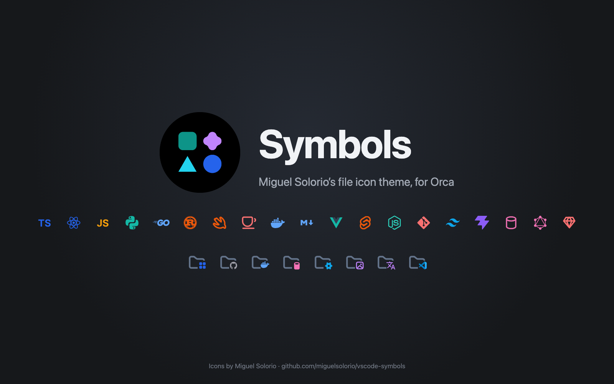
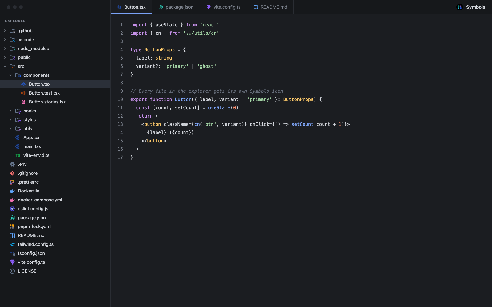
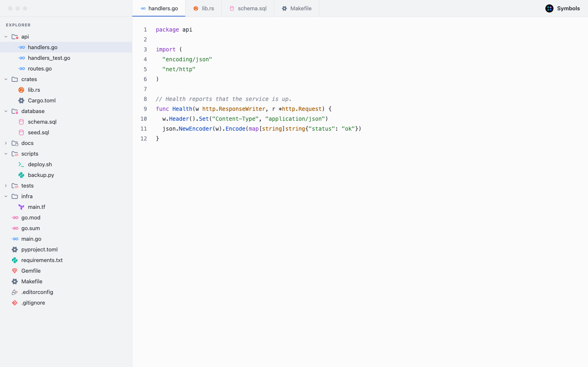
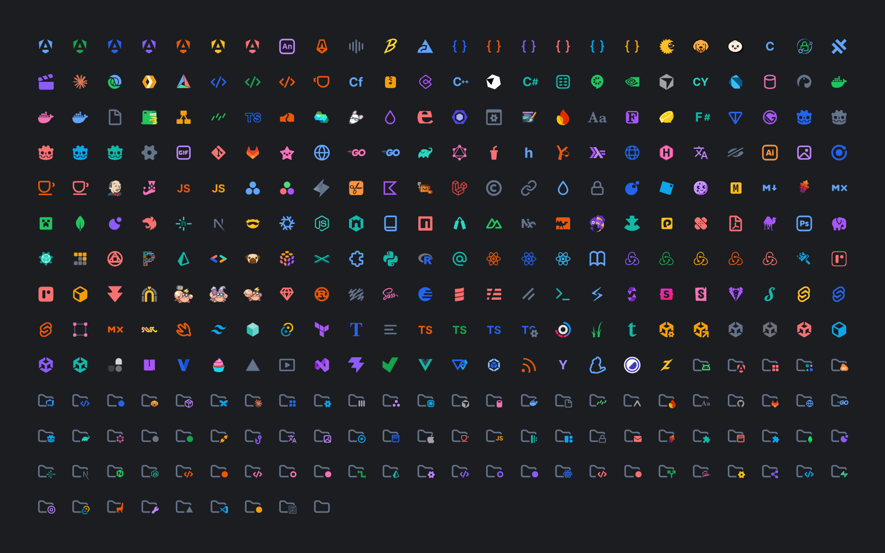

# Symbols for Orca



The [Symbols](https://github.com/miguelsolorio/vscode-symbols) file icon theme, ported from VS Code to Orca.

**All icons and design are the work of [Miguel Solorio](https://github.com/miguelsolorio)** and come from his [Symbols repository](https://github.com/miguelsolorio/vscode-symbols) ([VS Code Marketplace](https://marketplace.visualstudio.com/items?itemName=miguelsolorio.symbols)). This repository only converts them to Orca's icon theme format. It is not affiliated with or endorsed by the original author. To report a problem with an icon, or to ask for a new one, go to the [original repository](https://github.com/miguelsolorio/vscode-symbols/issues).

## Screenshots

**A TypeScript and React project**



**A polyglot project on a light theme**



**Every icon in the theme**



## Install

In Orca, open Settings → Plugins, search for **Symbols** and install it. Or, from a terminal:

```sh
orca plugin install marco-calderon/symbols-orca-icon-theme
```

Then pick **Symbols** as the file icon theme in Settings → Appearance.

## How it differs from the VS Code theme

The icons are Symbols' own SVGs, mapped to the same file names, extensions and folder names. Orca's icon theme format sets a few limits, so the port is close to the original but not identical:

- **512 mappings at most.** Orca allows 512 name mappings per icon theme, and Symbols maps over 1,400 (about 1,650 once language ids are counted). The port keeps the most common names first, then at least one name for each of the 320 icons Symbols maps, so every icon appears somewhere. A name that is left out shows the generic file or folder icon. [COVERAGE.md](COVERAGE.md) lists everything left out.
- **No language ids.** VS Code also picks icons by the language of a file. Orca matches names only, so the build turns each language id into the extensions and file names VS Code gives that language (for example `.vue`, `.php`, `.hpp` and `Makefile`).
- **Plain SVG only.** Orca draws shapes, gradients, clip paths and masks, nothing else. Two icons that styled shapes with CSS classes have those styles inlined. The `v` icon loses a faint blur and `folder-vscode` loses its drop shadow. Four large icons (`kubb`, `rsbuild`, `rslib`, `rspack`) are compressed with svgo to fit Orca's 64 KB per-icon limit.
- **No settings.** Symbols' VS Code settings (custom associations, hiding arrows or logo icons) have no Orca equivalent.

## Rebuild from upstream

`icons/` and `COVERAGE.md` are generated. To pick up a newer Symbols release:

```sh
git clone --depth 1 https://github.com/miguelsolorio/vscode-symbols.git ../vscode-symbols
npm install
npm run build -- ../vscode-symbols
orca plugin validate .
```

To change which names are kept, edit `scripts/priority.json`: the `essentials` list comes first, in the order written.

## Develop

```sh
orca plugin validate .
orca plugin dev watch .    # loads this folder into Orca and reloads on changes; Ctrl-C unloads it
```

## License

MIT. The icons, the Symbols logo and the original theme are © Miguel Solorio, under the [MIT License](LICENSE) of the [Symbols repository](https://github.com/miguelsolorio/vscode-symbols).
